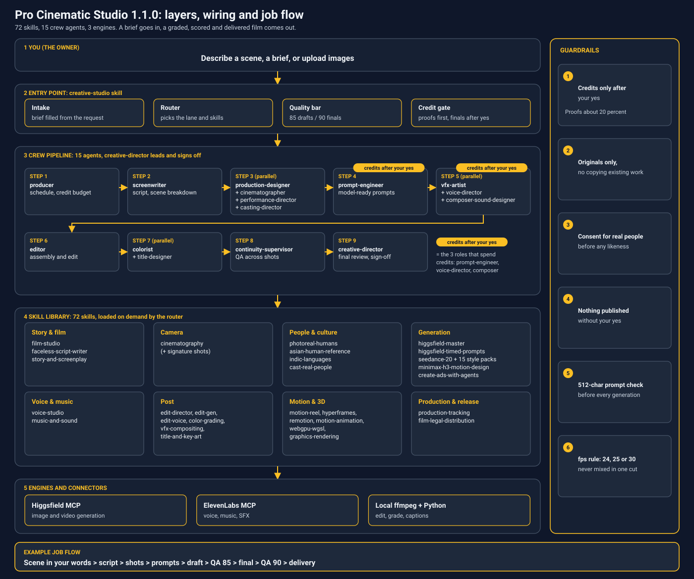

# Pro Cinematic Studio 1.0.0

> **Third-party licences:** this repo is public, so the components that came with no licence file (HyperFrames, the edit studio, Adil's skills, the Seedance packs), and Remotion with its company-size rule, are visible to anyone. If any of their owners object, the repo can be made private in GitHub settings. See THIRD_PARTY.md for every component and its source.

A Claude Code plugin that bundles a full AI film and video studio: 70 skills and 14 crew agents, wired together so a brief becomes a finished, graded, scored and delivered film or ad. Generation runs on Higgsfield (Seedance, Kling, Cinema Studio and others); voice runs on ElevenLabs; editing runs locally in Python and ffmpeg.

Licence: proprietary, owner licensed. Third-party components keep their own licences, see THIRD_PARTY.md.



**How it works**
1. You describe a scene, a brief or upload images; the `creative-studio` skill does intake, routing, the quality bar (85 drafts, 90 finals) and the credit gate.
2. The creative-director leads 13 crew agents in pipeline order, each pulling from the 70-skill library; only prompt-engineer, voice-director and composer-sound-designer can spend credits, and only after your yes.
3. Higgsfield MCP makes image and video, ElevenLabs MCP makes voice, music and SFX, and local ffmpeg + Python edits, grades and captions.

## Entry point

Start with the `creative-studio` skill. It routes a brief to the crew and the right skills. The creative-director agent runs the crew and has the final review.

## Crew and pipeline order

Org chart: the creative-director leads; every other agent reports to it.

1. producer: schedule, credit budget, tracking, legal and delivery checklists.
2. screenwriter: script and scene breakdown.
3. production-designer + cinematographer + performance-director (in parallel): world and look; shots, lenses and light; acting and blocking.
4. prompt-engineer: turns the above into model-ready prompts.
5. vfx-artist + voice-director + composer-sound-designer (in parallel): VFX and compositing; voices and languages; music and sound.
6. editor: assembly and edit.
7. colorist + title-designer (in parallel): grade; titles and key art.
8. continuity-supervisor: checks continuity across shots.
9. creative-director: final review and sign-off.

## Contents

- 70 skills in `skills/`: creative-studio, film-studio, cinematography, the Higgsfield and Seedance 2.0 packs (15 style folders, 01-cinematic to 15-real-estate), human realism and Indic-language skills, voice, music and sound, the edit trio (edit-director, edit-gen, edit-voice), color, VFX, performance, titles, legal, production tracking, motion, HyperFrames (hyperframes plus 13 hyperframes-* skills), Remotion (10 remotion-* skills, licence condition below), graphics, ads and faceless-video skills.
- 14 agents in `agents/`.

## Required connectors

- Higgsfield MCP (image and video generation).
- ElevenLabs MCP (voice, dubbing, sound).

Connect these in Claude Code yourself. No credentials are stored in this package.

## Local requirements

- ffmpeg 6 or later on PATH.
- Python 3 with, for edit-director: numpy, scipy, opencv-python-headless, onnxruntime, Pillow, PyYAML.
  `pip install numpy scipy opencv-python-headless onnxruntime Pillow PyYAML`
- Environment variable `ED_ROOT`: working root for edit-director (holds `input/`, `output/`, `work/`, `cache/`). If unset it defaults to `C:/Claude Code/cinema-studio/edit`. Set it to a folder you own.
- Models and fonts that are not shipped are downloaded on first use into the cache; see `skills/edit-director/engine/models/LICENSES.md`.
- Remotion skills need Node.js. HyperFrames skills need Node.js and a headless browser.

## Standing rules

- Credits are spent only after an explicit yes to a stated price.
- Originals only: no copying existing films, characters, brands or artists.
- Consent: no real person's face, voice or likeness without documented consent.
- Nothing is published, uploaded or sent without an explicit yes.

## Install and uninstall

This package is NOT installed by the build. The skills may already be active on your machine as personal skills in `~/.claude/skills`; installing the plugin as well would load duplicates. Pick one.

Try it without installing (loads for one session only):

    claude --plugin-dir "C:/Claude Code/cinema-studio/package/pro-cinematic-studio"

Skills then appear namespaced as `pro-cinematic-studio:<skill>`.

Install on a clean machine (or after you remove or rename the personal copies):

One-step install once the package is in a marketplace (Claude Code 2.1.275 or later): `/plugin install pro-cinematic-studio --marketplace <owner>/<repo>`

1. Unzip `pro-cinematic-studio-1.0.0.zip` to a folder, for example `C:/plugins/pro-cinematic-studio`.
2. Wrap it in a local marketplace (a folder holding `.claude-plugin/marketplace.json` that lists the plugin with `"source": "./pro-cinematic-studio"`), then:

       claude plugin marketplace add <marketplace-folder>
       claude plugin install pro-cinematic-studio@<marketplace-name>

3. Restart Claude Code, set `ED_ROOT`, connect the two MCP servers.

Uninstall:

    claude plugin uninstall pro-cinematic-studio
    claude plugin marketplace remove <marketplace-name>

Path note: bundled files that pointed at `~/.claude/skills/<bundled skill>/` now use `${CLAUDE_PLUGIN_ROOT}/skills/<bundled skill>/` so they resolve inside the plugin. Files that say "read ~/.claude/skills/<name>/SKILL.md if the Skill tool is unavailable" are generic fallbacks and apply only to personal-skill installs.

## Optional companions (not bundled)

Names referenced by bundled skills or agents that live outside this package. Everything works without them; they add engineering, marketing or design depth when present.

- Company agents: fullstack-engineer, qa-tester, tech-writer, growth-marketer, product-analyst, ui-designer, research-analyst, revenue-strategist.
- Company routers: it-company, caio (the `canonical-picks.md` reference).
- Marketing and brand skills: ad-creative, ads-agency-pro, banner-design, brand.
- Frontend and motion skills: framer-motion-skill, fixing-motion-performance, modern-web-design-standards, ram-web-developer.
- Language: i18n-tamil-hindi.
- Game and engine skills (graphics-rendering and webgpu-wgsl point at these): art-bible, asset-spec, asset-audit, godot, unreal-skill, unreal-mcp, unreal-create-toolset, browser-testing-with-devtools.
- ugc-hot-girl (persona skill named in higgsfield-master and photoreal-humans).

Plain English words that matched skill names in the scan (image, qa, spec, start, video, schema, social, freeze, benchmark, codex, slides, edge-to-edge, design-system) are not references.

## Licence flags

- Remotion (10 skills): free only for individuals and for-profit companies with 3 or fewer employees; a Company License is required beyond that. Each remotion-* SKILL.md keeps its licence note. Do not redistribute this package to a larger company without addressing it. See THIRD_PARTY.md.
- Several owner-authored skills carry `license: MIT` in their frontmatter, which differs from this plugin's proprietary licence. Left untouched; owner to decide.

## Changelog

- 1.0.0: first release. 70 skills, 14 agents, wired internally; third-party notices preserved; `${CLAUDE_PLUGIN_ROOT}` paths for bundled-skill references.
- Planned 1.0.1: story-and-screenplay to be added in 1.0.1 (the skill did not exist yet at build time).

## Install from GitHub

One step (Claude Code 2.1.275 or later):

```
/plugin install pro-cinematic-studio --marketplace rghrmkr1993/pro-cinematic-studio
```

Older versions:

```
/plugin marketplace add rghrmkr1993/pro-cinematic-studio
/plugin install pro-cinematic-studio
```
